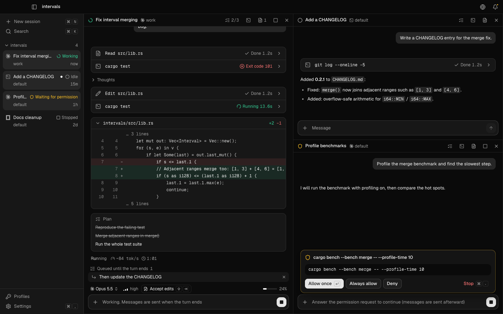
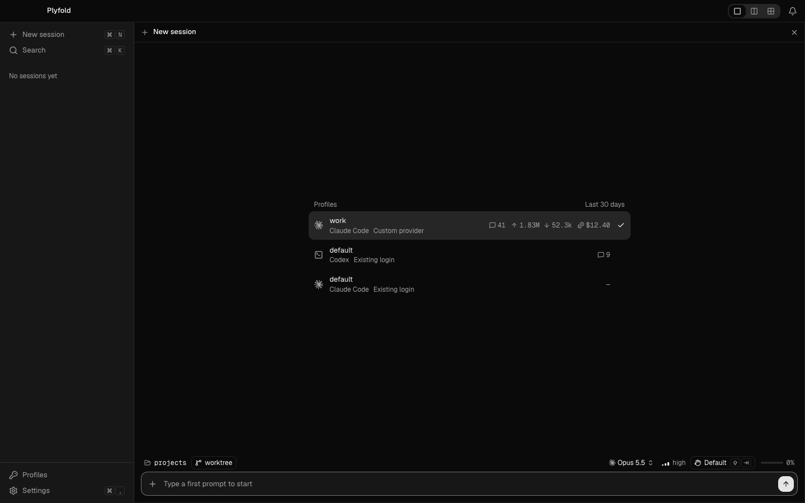

# Plyfold

[](https://github.com/Tettu0530/plyfold/actions/workflows/ci.yml)

Plyfold is a desktop app for macOS (and, in preview, Windows and Linux) for running coding agents side by side. It drives existing agent CLIs (Claude Code, Codex, OpenCode and Gemini CLI) over the [Agent Client Protocol](https://agentclientprotocol.com) (ACP). Each session gets its own git worktree, and you can keep several API keys for the same CLI.

Plyfold does not implement its own agent loop. It is an ACP client: the agent CLI does the model calls, tool use and file edits, and Plyfold launches it, shows what it does, answers its permission requests and handles the git side.



## Why

- **Multiple keys per CLI.** A *profile* is a CLI plus credentials plus a config directory. You can have a `work` and a `default` profile for Claude Code, each with its own key or endpoint, and pick one per session. Keys live in the macOS Keychain (the Credential Manager on Windows, the Secret Service on Linux) and are passed to the agent only as environment variables at launch.
- **One worktree per session.** Agents work in their own git worktree, so parallel sessions don't edit the same files and your checkout stays as it is. Diffs come from git, not from the agent, so they look the same for every CLI.
- **Panes.** A session is the record (ACP log, worktree, profile). A pane only shows a running session. Close a pane and the session is still there in the sidebar.
- **Motion.** Springs use the same formula as SwiftUI, and popovers and permission cards separate from the element they come from, like liquid. With Reduce motion turned on in macOS, animations become fades.



## Features

- Sessions grouped by repository in the sidebar, with their status (Working, Waiting for permission, Stalled, Idle, Stopped, Error) shown as an icon and a word
- Free pane layout: split any pane left, right, up or down, as many times as you like (⌘\ right, ⌘⇧\ down, or right-click a pane header). Drag the boundary between panes to resize them (double-click to split evenly), or even out every pane from the same menu
- Drag a session from the sidebar onto a pane to open it there, or onto a pane's edge to open it in a new split. Drag a pane by its header to move it next to another pane or swap the two; the drop area is outlined before you let go
- A resizable, collapsible sidebar (drag its edge; ⌘B to toggle), with a compact one-line-per-session layout in Settings
- Keyboard shortcuts can be changed in Settings → Keyboard (click one and press the new keys); macOS notifications for finished turns and permission requests can be turned off there too
- Settings also cover the display size (⌘= / ⌘- / ⌘0), reducing motion, the profile new sessions start with, reopening panes at launch, and whether the agent's thinking starts expanded
- Transcript with messages, thoughts, tool calls, inline diffs and the agent's plan; it follows new output only while you are at the bottom, with a button to jump back down
- Click an image (attached or sent) to view it large
- Preview pane: the globe button next to the notifications opens an empty one right away, listing the URLs agents printed. Open a dev server the agent started (localhost URLs found in command output, including background shells) or any URL in a pane, in a sandboxed frame with reload and "open in browser"
- Git in each session pane: the branch, how far it is ahead of the branch it will be merged into and of its upstream, the commits on it (unpushed ones marked) and the pull request with its checks and review state. Fetch, push, pull (fast-forward only) and create a PR from the same menu; network commands never wait for a password prompt and stop after 60 seconds
- Model, effort and mode switches under the composer (⇧⇥ cycles modes), plus context usage, tokens in and out, tok/s and cost where the agent reports them
- Messages typed during a turn are queued and sent when the turn ends; images and files can be attached from the + menu or with ⌘U, by pasting, or by dropping them on a pane
- Type `@` in the composer to pick a file from the session's working directory (git-tracked and untracked files, ignored ones left out); it is inserted as `@path` and attached as an ACP resource link
- Type `/` at the start of a message to complete the slash commands the agent offers (from ACP `available_commands_update`; new sessions use the commands remembered from the profile's last session)
- Permission cards inside the pane, also shown in the sidebar and as notifications
- A session is marked Stalled when nothing arrives during a turn for a set time (120 seconds by default)
- A Git pane per session, next to it (⌘⇧D): the branch, how it stands against its base and upstream, fetch / push / pull, the pull request and the commits, above the changes built from git (including untracked files) in unified and split layouts. A session working in the repository itself shows its uncommitted changes
- Side chat (⌘J): ask about a session in a read-only fork beside it, without adding to its conversation, even while it works
- From the Git pane (worktree sessions): commit, merge into the branch currently checked out in the original repository (`--no-ff`; on conflict the merge is aborted and the repository restored), push and open a pull request with `gh`, discard back to the base commit, or open the worktree in Zed, Cursor, VS Code or Finder
- More agents from the [ACP Registry](https://agentclientprotocol.com/registry) (Profiles → Add agents): agents started through npx or uvx are added to `config.toml` pinned to the registry's version, and can be updated or removed there
- Profiles per agent with three kinds of authentication: the CLI's existing login, the official API with a key, or a custom provider (base URL plus key)
- Optional separate config directory per profile, so its login and history don't mix with your usual CLI setup
- Connection test per profile: configured model, the model the agent reports, and time to first text. When the two models differ, sessions with that profile show the reported model in the pane header
- ⌘K to search sessions and commands
- Sessions can be reopened later. If the agent supports `session/load`, the conversation context comes back too
- Every ACP message is written to an event log, with secrets redacted

## Supported agents

These are built in. Plyfold starts each one as an ACP server over stdio.

| Agent | Command Plyfold runs | Config directory variable | Key variables not inherited by non-default profiles |
|---|---|---|---|
| Claude Code | `npx -y @agentclientprotocol/claude-agent-acp@0.107.0` | `CLAUDE_CONFIG_DIR` | `ANTHROPIC_API_KEY`, `ANTHROPIC_AUTH_TOKEN`, `ANTHROPIC_BASE_URL`, `CLAUDE_CODE_OAUTH_TOKEN` |
| Codex | `npx -y @agentclientprotocol/codex-acp@2.6.0` | `CODEX_HOME` | `OPENAI_API_KEY`, `CODEX_API_KEY` |
| OpenCode | `opencode acp` | `XDG_DATA_HOME` | `ANTHROPIC_API_KEY`, `OPENAI_API_KEY`, `GEMINI_API_KEY` |
| Gemini CLI | `npx -y @google/gemini-cli@0.68.0 --experimental-acp` | none | `GEMINI_API_KEY`, `GOOGLE_API_KEY` |

The adapter versions are pinned. OpenCode must already be installed and on your `PATH`. The others are fetched by `npx` on first use. Gemini CLI has no config directory variable, so its profiles cannot use a separate config directory.

A default profile (just the agent name) passes your environment through unchanged and uses whatever login the CLI already has. A profile that sets keys or a separate config directory drops the variables in the last column from the inherited environment, so keys from your shell never leak into it.

You can override these definitions or add other ACP agents in `config.toml` under `[agents.<name>]`. There is also a `mock` agent (`plyfold-mock-agent`) for development, which uses no tokens.

## Install

Download the installer for your system from the [latest release](https://github.com/Tettu0530/plyfold/releases): a `.dmg` for macOS (Apple silicon and Intel), a `.exe` or `.msi` for Windows 10/11, and an AppImage or `.deb` for Linux. The release notes say how to get past the warning the system shows for an unsigned app.

You also need the agent CLIs you want to use, with their logins or API keys. `npx` (bundled with [Node.js](https://nodejs.org)) is enough for Claude Code, Codex and Gemini CLI; OpenCode needs `opencode` installed. For creating pull requests from the Git pane, install the [GitHub CLI](https://cli.github.com) and log in.

## Requirements for building

- macOS, Windows 10/11, or Linux with WebKitGTK 4.1 (Windows and Linux support is new: please report what doesn't work)
- Xcode Command Line Tools on macOS; on Windows, the Microsoft C++ Build Tools and WebView2 (already part of Windows 11)
- On Linux, the [Tauri prerequisites](https://v2.tauri.app/start/prerequisites/#linux) plus libdbus (Debian and Ubuntu: `libwebkit2gtk-4.1-dev libayatana-appindicator3-dev librsvg2-dev libxdo-dev libssl-dev libdbus-1-dev`), and a Secret Service such as GNOME Keyring or KWallet for API keys
- Rust, latest stable (via [rustup](https://rustup.rs)). The workspace uses edition 2024
- Node.js 22.12 or later, with npm
- git
- The agent CLIs you want to use, and their logins or API keys. `npx` (bundled with Node) is enough for Claude Code, Codex and Gemini CLI. OpenCode needs `opencode` installed
- Optional: [GitHub CLI](https://cli.github.com) (`gh`), logged in, for creating pull requests from the Git pane

## Building and running from source

```sh
git clone https://github.com/Tettu0530/plyfold.git
cd plyfold/apps/desktop
npm install
npm run tauri dev
```

`npm run tauri dev` starts the Vite dev server on port 1420 and builds and launches the app. The first Rust build takes a while.

`npm run tauri build` builds an app bundle. It is not signed or notarized.

Tests:

```sh
cargo test --workspace     # from the repository root
cd apps/desktop && npm test
```

There is also a headless development CLI that drives the same engine:

```sh
cargo run -p plyfold-cli -- profiles
cargo run -p plyfold-cli -- start claude --repo /path/to/repo
```

## Where settings and data live

Everything is under `~/Library/Application Support/plyfold/`:

| Path | Contents |
|---|---|
| `config.toml` | Profiles and agent overrides |
| `settings.json` | App settings (language, display size, motion, send key, keyboard shortcuts, notifications, editor, stall timeout, worktree and profile defaults) |
| `plyfold.db` | Sessions and the ACP event log (SQLite) |
| `worktrees/` | One git worktree per session |
| `profiles/<name>/` | Separate config directories for profiles that use one |

On Windows the same files are under `%APPDATA%\plyfold\`, and on Linux under `~/.local/share/plyfold/`.

API keys are not stored in these files. They are kept in the macOS Keychain (on Windows, the Credential Manager; on Linux, the Secret Service) under the service name `plyfold`, with the account `<profile>/<VARIABLE>`. The UI shows only the last four characters.

## Project layout

```
apps/desktop/          Tauri 2 app: React + TypeScript UI (src/), Rust commands (src-tauri/)
crates/
  plyfold-acp          ACP client (JSON-RPC over stdio) and plyfold-mock-agent
  plyfold-profile      Profiles, Keychain access, built-in agent definitions
  plyfold-store        Sessions and the event log (SQLite)
  plyfold-worktree     Per-session worktrees, diffs, commit / merge / PR / discard
  plyfold-core         The engine: ties the crates above together and emits events to the UI
  plyfold-i18n         Engine messages in Japanese, English and Simplified Chinese
  plyfold-cli          Development CLI (plyfold profiles / sessions / start / resume / log / diff / rm / keys)
  plyfold-probe        ACP checks and benchmarks across agents
docs/                  Design notes, i18n rules, probe findings, screenshots
tools/liquid-probe/    Measures Apple's Liquid Glass motion to tune the animations
```

See [DESIGN.md](DESIGN.md) for the design decisions and [docs/probe-findings.md](docs/probe-findings.md) for how the agents differ over ACP.

## Languages

The UI is available in Japanese, English and Simplified Chinese. By default it follows the macOS language and falls back to English. You can change it in Settings.

## Status

Plyfold is early. The builds are not signed or notarized yet. Expect rough edges and breaking changes to `config.toml` and the database.

## Contributing

Contributions are welcome. Please read [CONTRIBUTING.md](CONTRIBUTING.md) and the [Code of Conduct](CODE_OF_CONDUCT.md). To report a security issue, see [SECURITY.md](SECURITY.md) and do not open a public issue.

## Acknowledgements

Plyfold is built on [Tauri](https://tauri.app), [React](https://react.dev), [Radix UI](https://www.radix-ui.com) with [shadcn/ui](https://ui.shadcn.com) patterns, [Motion](https://motion.dev), [Zustand](https://zustand.docs.pmnd.rs) and the [Agent Client Protocol](https://agentclientprotocol.com). It ships the [Geist and Geist Mono](https://vercel.com/font) typefaces (SIL Open Font License 1.1), icons from [Lucide](https://lucide.dev) (ISC) and agent logos from [Simple Icons](https://simpleicons.org) (CC0). Product names and logos belong to their owners; Plyfold is not affiliated with Anthropic, OpenAI, Google or the OpenCode project.

The screenshots use made-up sessions and numbers.

## License

[MIT](LICENSE)
